# Assessment Diary

**Step 1:** I tried to understand the assessment requirements before starting the assessment

**Step 2:** I read and understood the requirements after starting the assessment, giving the requirements to AI to make sure I didn’t miss anything in my understanding of the requirements

Document My understanding of requirements:

1. Document creation and editing (create/rename/edit/save/reopen with basic rich text - bold, italic, underline headings and lists)
1. File Upload (Upload a text or MD and turn it into document)
1. Sharing 1 owner (visible difference between owned vs shared documents)
1. Fake users/seeded accounts are fine
1. Persistence should survive document refresh, and formatting holds up
1. SQL Lite or local file store is completely acceptable for the MVP
1. Error handling and automented, plus unit tests for each functionality are mandatory
1. Agents.md for agent standard instructions to be included with every prompt
1. Architecture.md for architecture of the product
1. Changelog.md for every single change for every single file touched, why, with timestamps
1. Local-setup.md for easy instructions on how to setup local environment
1. Testing-guide.md for guide on tests for each functionality
1. Roadmap.md for step by step plan, what is done, what is left

**Step 3**: Write functional/non functional requirements of the system

**Step 4:** Technical proposal of solutions. I planned approaches on how to go about completing this project from scratch, what tech stack options I have and why.

I consulted with AI on this, some of the options I have

| **Criterion** | **A. React + Fastify + SQLite** | **B. Next.js full-stack** | **C. React + .NET** | **D. React + Supabase** |
|---|---|---|---|---|
| Initial development speed | High | Very high | Medium-high | Very high |
| Architecture clarity | Very high | High | Very high | Medium-high |
| Unit testing business logic | Very high | High | Very high | High |
| API/integration testing | Very high | High | Very high | High |
| Rich-text support | Excellent | Excellent | Excellent | Excellent |
| Local setup without accounts | Excellent | Excellent | Excellent | Moderate |
| Persistence without a database server | Excellent | Possible | Excellent | No, not with hosted PostgreSQL |
| Sharing and authorization | Explicit backend logic | Explicit server logic | Explicit backend logic | SQL policies plus client/server logic |
| Deployment simplicity | Medium | High | Medium | High |
| External service dependency | Low | Low | Low | High |
| Architectural flexibility | Very high | High | Very high | Medium |
| Risk of unnecessary complexity | Low-medium | Low-medium | Medium | Low-medium |

Apart from this, I also considered other options

In the end, I decided to go with React in TS + Tiptap + Supabase Posgres because:

1. **React**: I can update one part of the screen without rebuilding the entire page. React handles the interface, but it does not provide a database or rich-text editor by itself.
1. **TypeScript**: catches mistakes while coding
1. **Vite**: I can start building quickly without introducing a full-stack framework
1. **Tiptap**: provides the rich-text editor and plus its core editor is MIT-licensed open-source software. We can use it in a commercial product, host our own data, and build our own features without subscribing to Tiptap's paid platform.
  1. I did consider what will happen when the application grows, would we need to upgrade to a paid plan. And the answer is, no.We won't need to pay Tiptap just because we have more users or documents.
1. Supabase Postgres: Data remains available after refresh and across sessions. It also avoids relying on a local database file that might disappear when a hosting server restarts.Supabase also offers authentication, so you do not have to implement password storage and session management yourself if you need genuine user accounts.

**Step 5: Planning**

I created a plan for how to execute the MVP product in a timeboxed manner. The initial proposal was this:  

| Time budget | Focus | Acceptance criteria |
|---|---|---|
| Phase 1 | Scaffold, database, Tiptap and basic UI | Application runs, editor renders, document list loads |
| Phase 2 | Document CRUD and persistence | Create, rename, edit, save, reopen, delete and order documents; content survives refresh |
| Phase 3 | Rich-text editor fidelity | Toolbar, headings, links, tables, images and alignment work; formatting survives save/reopen |
| Phase 4 | Import and sharing | Upload and parse a supported file into a new document; grant/revoke sharing and display shared documents |
| Phase 5 | Authentication and authorization | Sign up, sign in, logout and switch users; private documents are inaccessible to unauthorized users; revoked access returns 403 |
| Phase 6 | Integration and persistence tests | CRUD, import and sharing work end to end; test user isolation and refresh persistence |
| Phase 7 | Fix failures and deploy | Resolve critical failures; deployment succeeds and the main flow works in the deployed application |
| Phase 8 | Documentation and final check | Setup instructions, environment variables, migration steps and known limitations are documented |

I then used AI to check if my plan adhered to all the requirements and constraints of the project. And surely enough, there were things I was missing.

Then, it gave me an updated timeboxed plan

| **Phase** | **Implementation focus** | **Testing and acceptance criteria** |
|---|---|---|
| 1 | Scaffold, architecture and test setup | Test runner configured; one baseline test passes; Agents.md and Architecture.md created |
| 2 | Document CRUD and persistence | Tests for create, rename, edit, save, reopen, delete and refresh persistence |
| 3 | Rich-text editor | Tests for bold, italic, underline, headings, bulleted lists, numbered lists and formatting persistence |
| 4 | File upload | Tests for .txt and .md imports, content conversion, unsupported files and invalid input |
| 5 | Seeded users and sharing | Tests for ownership, sharing grants, owned/shared lists, revocation and persistence across refresh |
| 6 | Error handling and test completion | Tests for failed saves, invalid inputs, missing documents and unauthorized access; fix failures |
| 7 | Integration and usability | End-to-end tests for the main workflow across two seeded users; run the full test suite |
| 8 | Documentation and final verification | Update all six required Markdown files; run all tests and report failures, limitations and remaining work |

#### Required documentation checklist

These are deliverables, not optional cleanup tasks.

- Agents.md: instructions that must accompany every agent prompt, including coding standards, testing and changelog requirements.
- Architecture.md: components, data model, persistence, ownership and sharing design.
- Changelog.md: timestamped record of every changed file, what changed and why.
- Local-setup.md: prerequisites, installation, configuration and commands to run locally.
- Testing-guide.md: automated test commands, coverage by functionality and manual verification steps.
- Roadmap.md: completed work, outstanding requirements, known limitations and what to build next in 2–4 hours.

**Step 6: Create** **Agents.md**

I created agents.md for instructions of the scope of the project, the constraints and standards the agent has to follow with each prompt and with the definition of Done.

**Step 7: Create** **Plan.md**

I created plan.md for the final decided plan on how to complete the project in the timeboxed, testable, phased approach.

**Step 8: Create initial prompt**

I then created an initial prompt, making sure to include as much relevant details in it as possible and tell the LLM not to write anything, but just tell me its understanding of what the problem is first, what it thinks it needs to do, so I can evaluate if its understanding is correct or I need to change the model.

**Step 9: Get understanding of LLM** and **start Phase 1 with completion report**

After getting the understanding of LLM, I approved the phase 1 with a completion report, making sure its a testable version.

**Step 10: Run end to end tests for phase 1 and test it manually**

After getting the phase 1 done, I tested the output myself running the server and frontend.

First working version:

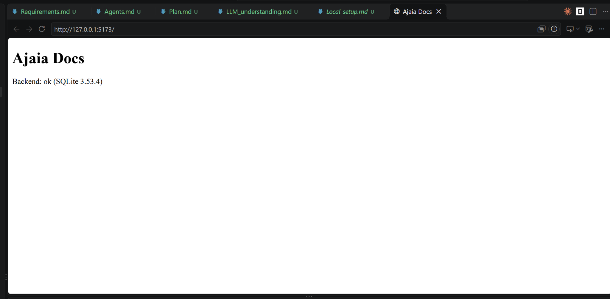

Output after Phase 2:

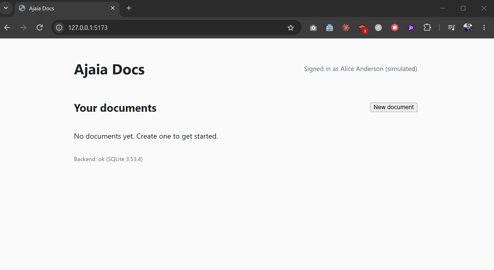

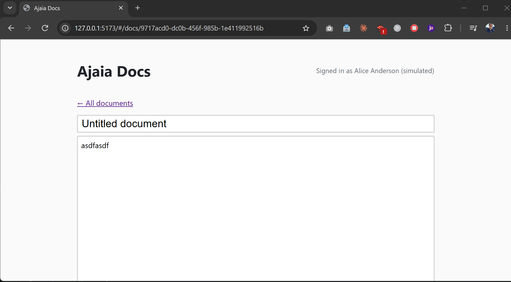

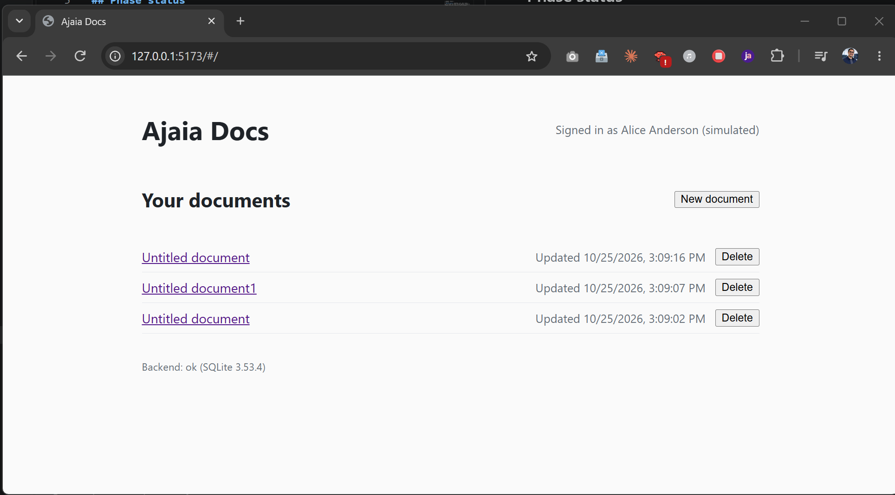

Phase 3 output

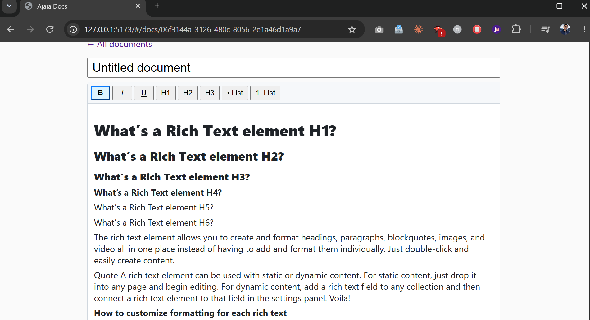

**Step 11: At this point, I started to work on the UI in parallel. I used claude to generate a premium UI for this product**

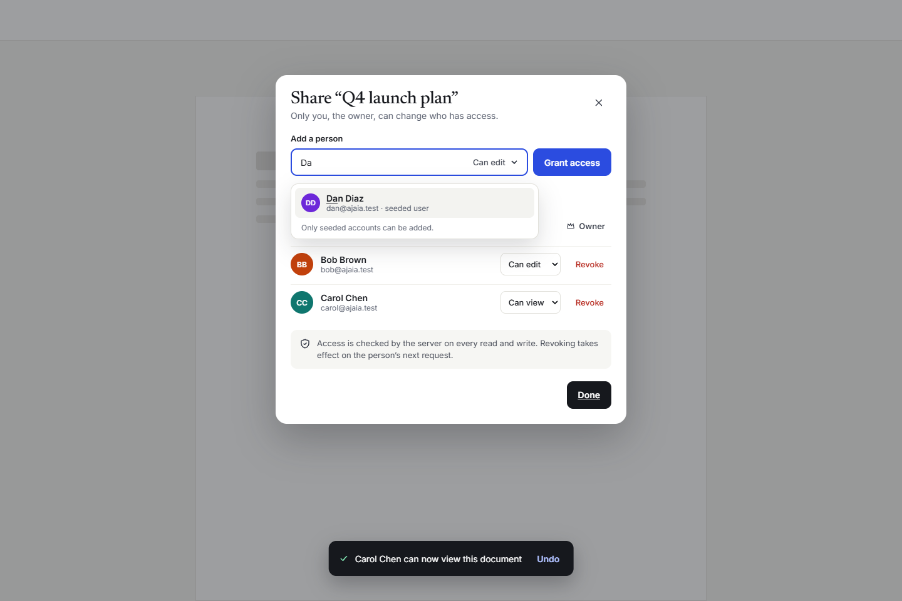

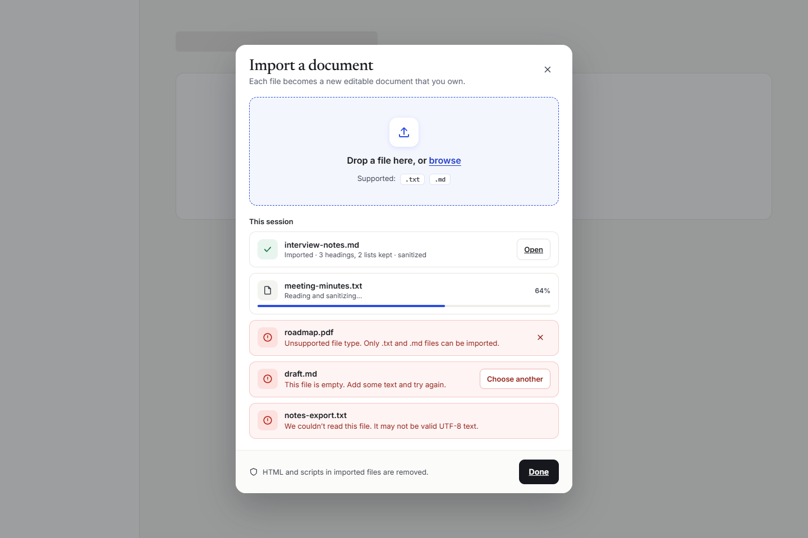

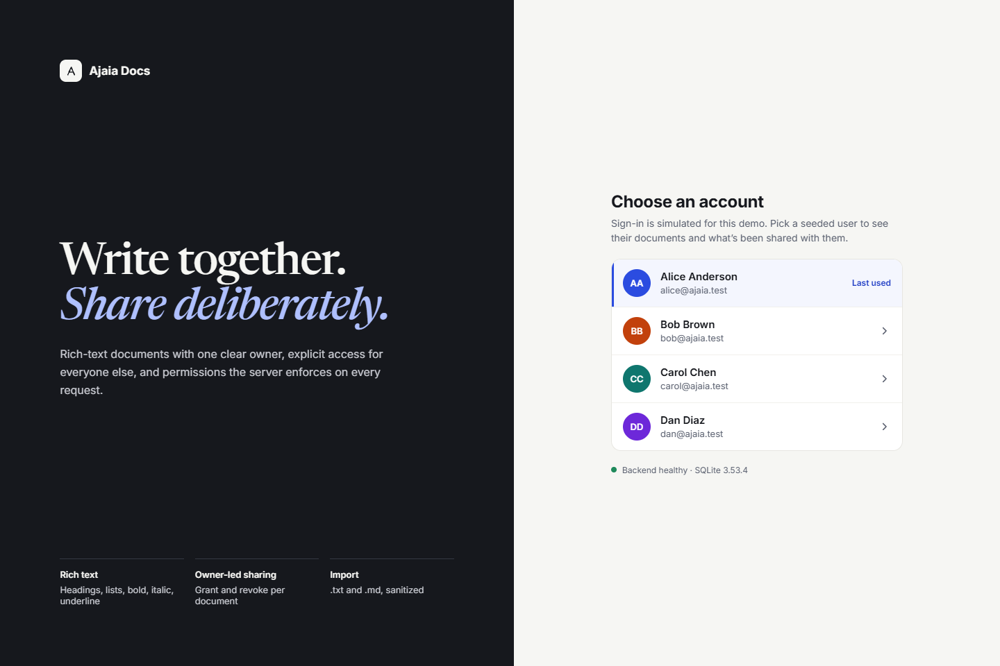

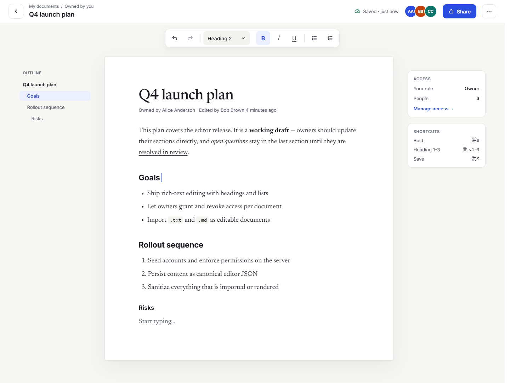

  
  
**Step 12: Phase 4: Import**

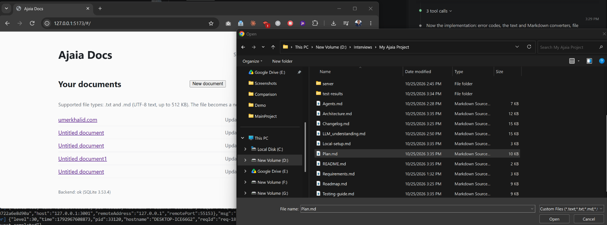

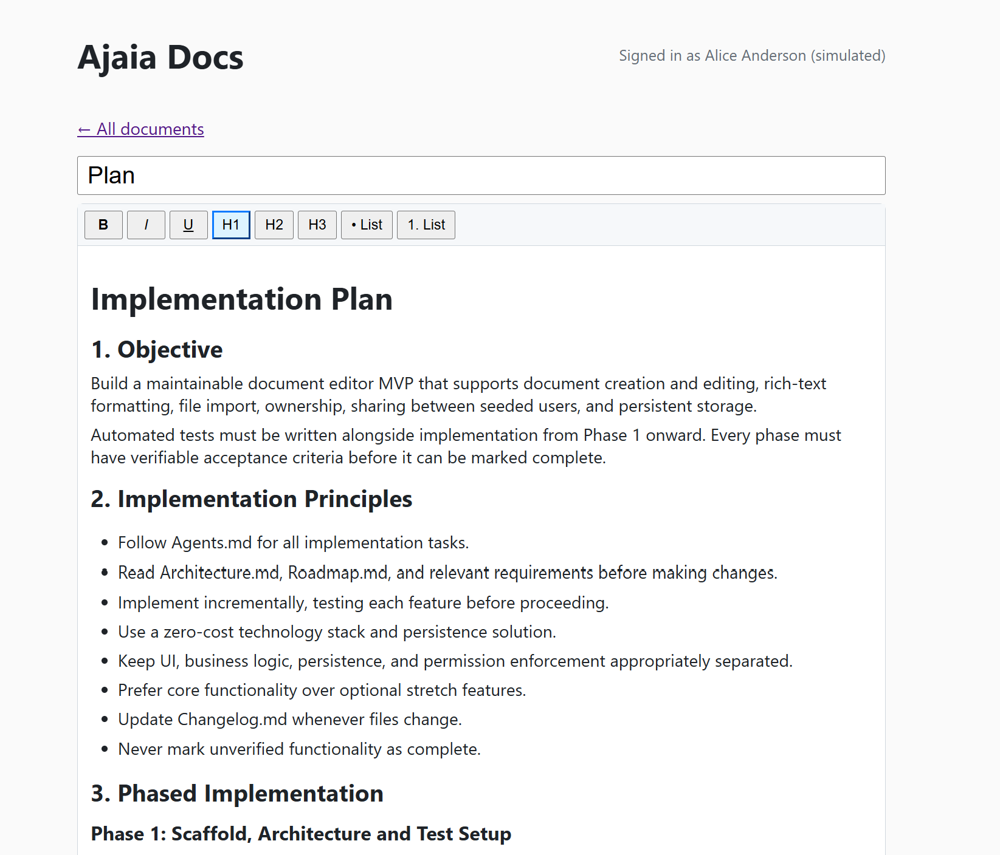

**Step 13: Phase 5: Auth and Sessions**

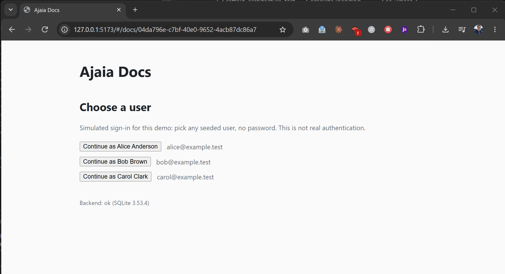

**Sharing docs**

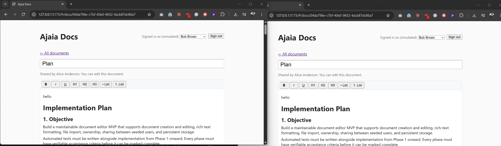

**Step 14: Concurrency and Auto Sync**

This is something I verified at this point did not work and one user’s changes replaced the other user’s changes. In a production ready system, this is unacceptable. So at this point, I implemented auto sync feature.

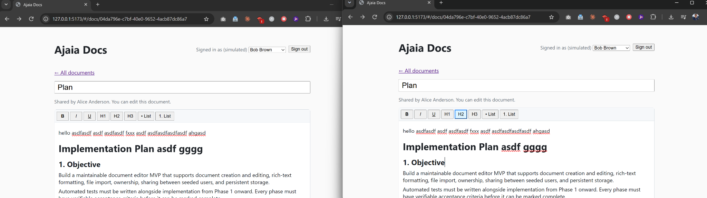
